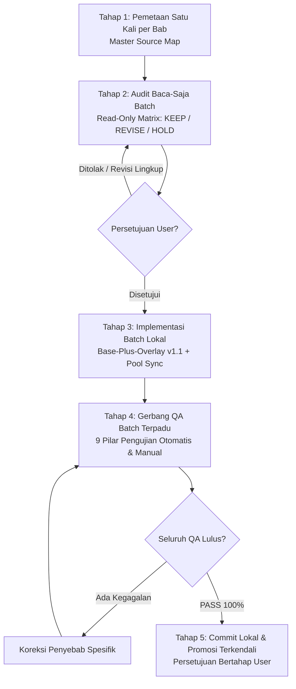

# PROSEDUR OPERASIONAL STANDAR (SOP)
## Produksi & Rekonsiliasi Bank Soal Berbasis Batch v2.0
**Repositori:** `rpg-kelas-XII` 
**Status Dokumen:** APPROVED OPERATIONAL PROCEDURE 
**Berlaku untuk:** Seluruh mata pelajaran, bab, misi, dan bank soal 
**Tanggal Penetapan:** 23 Oktober 2026 
**Dokumen Pendamping & Otoritas Acuan:**
- `Alur Kerja Proyek/00-MASTER-CONTROL.md` (Part 1 — Catatan Kanonikal Awal)
- `Alur Kerja Proyek/00-MASTER-CONTROL-v1.1.md` (Part 2 — Kelanjutan Kanonikal Aktif)
- `Alur Kerja Proyek/MASTER-CONTROL-CONTINUATION-NOTICE.md`
- `Alur Kerja Proyek/01-GDD-ACADEMIC-ASCENSION-RPG.md`
- `Alur Kerja Proyek/REQUIRED-WORK-SESSION-PROTOCOL.md`
- `Alur Kerja Proyek/PROJECT LOG/decisions/009-content-source-and-copyright-safe-pipeline.md`

---

## 1. Latar Belakang & Tujuan Transformasi Batch

Dalam fase perakitan bank soal kurikulum kelas XII sebelumnya, alur kerja dijalankan dengan siklus mikro satu per satu misi (*single-mission micro-cycle*). Praktik tersebut menimbulkan inefisiensi signifikan: pengulangan penelusuran buku sumber yang sama, pengulangan pembacaan skema, validasi berulang untuk setiap perubahan kecil, lonjakan konsumsi prompt/konteks model AI, serta risiko tersebarnya perubahan parsial yang sulit dilacak.

**SOP v2.0 menetapkan transisi penuh ke alur kerja berbasis batch (3–5 misi per kelompok kerja)** dengan tujuan:
1. **Mengurangi Inefisiensi:** Menghilangkan redundansi audit, pembacaan buku acuan, dan pengujian mikro per-butir soal.
2. **Menjaga Standar Mutu Akademik:** Setiap butir soal diuji ketepatan konsep, kunci jawaban, kejelasan langkah penyelesaian, dan validitas distraktor salahnya.
3. **Menegakkan Orisinalitas & Kepatuhan Hak Cipta (Decision 009):** Buku Kurikulum Merdeka dijadikan referensi konsep dan capaian pembelajaran internal; teks soal, skenario konteks, opsi, dan distraktor disusun secara mandiri dan orisinal tanpa menyalin kalimat buku teks.
4. **Menjamin Integritas Versi (Base-Plus-Overlay v1.1):** Berkas kanonikal v1.0 dilindungi dan tidak boleh diubah. Pembaruan dikelola melalui berkas overlay revisi dan kanonikal v1.1 terpisah.
5. **Menjamin Keselamatan Git:** Pekerjaan diselesaikan secara lokal tanpa manipulasi staging, commit, atau push tanpa izin eksplisit; perintah destruktif dilarang.

---

## 2. Empat Mode Operasi Tugas (Mandatory Task Operating Modes)

Untuk menjaga batas kerja yang ketat, **setiap sesi atau tugas baru wajib secara eksplisit mencantumkan salah satu mode operasi resmi berikut**:

| Mode Operasi | Sifat Pekerjaan | Izin Modifikasi Berkas | Output Wajib |
| :--- | :--- | :--- | :--- |
| **`READ-ONLY AUDIT`** | Audit baca-saja materi & teknis | **DILARANG KERAS** mengubah berkas apa pun di repositori | Matriks temuan audit (`KEEP`, `REVISE`, `HOLD`) |
| **`LOCAL BATCH IMPLEMENTATION`** | Penulisan revisi batch yang telah disetujui | Menulis overlay v1.1, kanonis v1.1, dan sinkronisasi pool | Berkas overlay, kanonis v1.1, dan pool termutakhirkan secara lokal |
| **`QA AND VERIFICATION`** | Pengujian komprehensif batch | Mengoreksi berkas implementasi bila QA menemukan cacat | Laporan uji 9 pilar QA (PASS/FAIL) |
| **`LOCAL COMMIT`** | Pencatatan checkpoint Git lokal | Staging ketat dan commit lokal | Git commit ID lokal baru tanpa push |

> [!IMPORTANT]
> Agen atau pengembang dilarang beralih dari satu mode ke mode berikutnya tanpa persetujuan eksplisit dari Pengguna (*User*).

---

## 3. Alur Kerja 5 Tahap Produksi Batch

---

### Tahap 1 — Pemetaan Satu Kali per Mata Pelajaran & Bab (Master Source Map)

Tahap ini dilakukan **sekali di awal setiap bab** dan hasilnya dapat digunakan kembali (*reusable*) untuk seluruh misi dalam bab tersebut tanpa perlu mengulang penelusuran pustaka.

1. **Inventarisasi Menyeluruh Butir Soal per Bab:**
   - Petakan seluruh berkas misi, ID soal Phase 3, ID soal Phase 4 pool, jumlah butir, versi skema, status saat ini, dan penempatan fisik setiap butir.
   - Identifikasi apakah butir soal aktif dimuat oleh runtime HTML (`academic-ascension-rpg-v1.html`, `world-1-rpg-v2.html`, atau hub terkait) atau hanya tersimpan di pool cadangan.
2. **Pemetaan Pustaka Resmi Kurikulum Merdeka:**
   - Petakan Buku Siswa (BS) dan Buku Panduan Guru (BG) edisi resmi yang tersimpan di `Buku Kurikulum/Kurikulum Merdeka/`.
   - Catat bab, subbab, konsep spesifik, capaian pembelajaran (CP/ATP), aktivitas panduan guru, dan rentang halaman nyata.
   - **Aturan Integritas Sumber:** Dilarang mencantumkan nomor halaman buku jika belum diverifikasi langsung pada berkas sumber lokal (Markdown/PDF). Jangan menggunakan data placeholder atau asumsi.
3. **Penyelarasan Lokasi Konten & Pipeline Teknis:**
   - Periksa konsistensi antara data Phase 3 (kanonikal per-misi), Phase 4 (kumpulan pool mata pelajaran), recipe/backend simulator (`validate_recipes.ps1`, `engine/tests/smokeTest.js`), dan runtime antarmuka.
4. **Analisis Hak Cipta & Orisinalitas (Kepatuhan Decision 009):**
   - Identifikasi apakah ada butir soal warisan yang menyalin angka, nama karakter, kalimat latihan, atau diagram buku teks secara langsung.
   - Pastikan bahwa buku acuan hanya dijadikan dasar konsep akademik, bukan materi untuk dijiplak.
5. **Output Kanonikal Tahap 1:**
   - Dihasilkan satu dokumen **Master Source Map** per bab (disimpan pada dokumentasi bab atau laporan audit) yang mendokumentasikan rujukan bab secara terstruktur untuk dimanfaatkan oleh seluruh misi dalam bab tersebut.

---

### Tahap 2 — Audit Baca-Saja Berbasis Batch (Read-Only Batch Audit)

Tahap audit dilakukan dalam satu kelompok kerja yang mencakup **3 sampai 5 misi sekaligus** (atau satu bab utuh bila skala butirnya ringkas), untuk memberikan gambaran komprehensif atas koherensi materi dan progresi belajar.

1. **Ukuran Batch & Efisiensi:**
   - Kelompokkan 3–5 misi yang saling berkaitan secara materi.
   - Misi yang sudah berstatus selesai, lulus QA, dan disetujui (*approved*) **tidak boleh diaudit ulang** kecuali ada laporan cacat (*bug report*) baru yang spesifik.
2. **Dimensi Telaah Kritis Setiap Butir Soal:**
   - **Kebenaran Materi & Perhitungan:** Kebenaran konsep ilmiah/matematis, ketepatan data linguistik, keakuratan angka, dan tidak adanya ambiguitas logika.
   - **Ketepatan Kunci Jawaban:** Kunci jawaban harus tunggal, pasti benar, dan tidak terbantahkan.
   - **Kualitas Pembahasan & Langkah Penyelesaian:** Pembahasan menyajikan langkah sistematis, formula yang digunakan, dan penalaran konsep yang mendidik.
   - **Analisis Distraktor (Opsi Pengecoh):** Setiap opsi salah wajib mewakili miskonsepsi atau kesalahan prosedur yang nyata (bukan angka acak). Alasan kesalahan masing-masing opsi salah wajib diuraikan dalam pembahasan.
   - **Kesesuaian Taksonomi Bloom & Kesulitan:** Verifikasi konsistensi `skill` dan `cognitive_level` (`understand` / `apply` / `analyze`) sesuai tuntutan kognitif soal. Pastikan `difficulty` (`easy`, `medium`, `hard`) mencerminkan beban tantangan populasi.
   - **Provenance & Kepatuhan Decision 009:** Verifikasi keaslian stimulus skenario dan kelengkapan metadata `source_basis` (mencakup `curriculum_framework`, `competency_target`, `concept_reference`, dan `authoring_statement`).
   - **Integritas Teknis:** Format ID unik, kesesuaian tipe data, dan kompatibilitas opsi A–D.
3. **Klasifikasi Putusan Butir Soal:**
   - **`KEEP`**: Butir soal memenuhi seluruh standar mutu akademik, orisinalitas, dan teknis. Dipertahankan tanpa modifikasi.
   - **`REVISE`**: Butir soal memiliki cacat materi, kelemahan distraktor, inkonsistensi metadata, atau memerlukan penguatan orisinalitas konteks. Butir ini masuk daftar kerja revisi batch.
   - **`HOLD`**: Butir soal terindikasi memiliki risiko hak cipta tinggi, sengketa konsep berat, atau ketiadaan rujukan buku yang sah. Ditangguhkan dari perakitan sampai kendala terselesaikan.
4. **Batasan Mutlak Tahap 2:**
   - Status pengerjaan adalah **MURNI BACA-SAJA (READ-ONLY)**.
   - Dilarang membuat, memodifikasi, menghapus berkas, atau melakukan perubahan Git apa pun selama Tahap 2.
5. **Output Kanonikal Tahap 2:**
   - Satu **Matriks Temuan Audit Batch** ringkas yang menyajikan tabel per butir soal: ID soal, materi/topik, putusan (`KEEP`/`REVISE`/`HOLD`), ringkasan temuan, dan usulan tindakan revisi spesifik.

---

### Tahap 3 — Implementasi Batch Setelah Persetujuan (Local Batch Implementation)

Implementasi hanya boleh dieksekusi setelah pengguna memeriksa Matriks Temuan Audit Tahap 2 dan memberikan persetujuan eksplisit atas lingkup perbaikan.

1. **Disiplin Lingkup Kerja:**
   - Kerjakan seluruh revisi butir `REVISE` yang telah disetujui dalam batch tersebut secara tuntas.
   - Jangan menyentuh butir `KEEP` kecuali ditemukan kesalahan baru yang fatal dan terbukti secara teknis.
   - Jangan memaksakan perbaikan butir `HOLD` sebelum hambatan sumber atau hak ciptanya terselesaikan secara formal.
2. **Penerapan Arsitektur Base-Plus-Overlay v1.1:**
   - **Kanonikal v1.0 Terkunci Mutlak:** Berkas `*-canonical-v1.0.json` tidak boleh disentuh, dimodifikasi, atau ditimpa. Perintah `git diff HEAD -- <canonical-v1.0.json>` wajib menghasilkan selisih kosong.
   - **Penyusunan Berkas Overlay Revisi v1.1:**
     * Disimpan di `phase-3/` dengan penamaan `world-X-...-misi-N-v1.1-revisions.json`.
     * `schema_version`: `"1.1"`, status: `"qa_pending"`.
     * Kolom `before_question` wajib mencocokkan teks v1.0 secara persis (karakter per karakter).
     * Kolom `after_question`, `answer`, `replacement_options`, `explanation`, `skill`, `cognitive_level`, `difficulty`, `source`, `provenance`, dan `source_basis` memuat konten hasil revisi yang telah disetujui.
   - **Penyusunan Berkas Kanonikal v1.1:**
     * Disimpan di `phase-3/` dengan penamaan `world-X-...-misi-N-canonical-v1.1.json`.
     * `schema_version`: `"1.1"`, status: `"CONTROLLED_REVISION_DRAFT"`.
     * Merupakan hasil resolusi deterministik dari basis v1.0 ditambah overlay v1.1.
     * Status `CANONICAL_APPROVED` hanya boleh diberikan setelah lulus seluruh gerbang QA dan disetujui pengguna.
3. **Sinkronisasi Terpadu ke Phase 4 Pool:**
   - Perbarui butir soal terkait pada berkas pool mata pelajaran di `phase-4-pools/` (misal: `pool-matematika-MAT12-C01.json`).
   - Pertahankan ID soal Phase 4 yang sudah ada (misal: `MAT12-C01-A-8901`) untuk menjaga kompatibilitas keterlacakan.
   - Pastikan teks soal, opsi, kunci, penjelasan, dan metadata sinkron 100% dengan kanonis v1.1.
4. **Kebijakan Perubahan Runtime HTML:**
   - Berkas runtime (`prototype/academic-ascension-rpg-v1.html` atau visual novel) **HANYA diubah jika butir soal yang direvisi merupakan soal aktif yang dimuat dalam pertempuran**, dan perubahan tersebut masuk dalam persetujuan batch.
   - Jika butir soal hanya berada di pool cadangan dan tidak dimuat oleh ronde pertempuran aktif, berkas runtime dilarang dimodifikasi.

---

### Tahap 4 — Gerbang QA Batch Terpadu (Batch QA Gate)

Pengujian kualitas dilakukan **sekali secara komprehensif untuk seluruh batch yang telah diimplementasikan**, bukan berulang-ulang pada setiap perubahan kecil.

Semua 9 pilar pemeriksaan berikut wajib dijalankan dan diverifikasi:

1. **Integritas Sintaks JSON & Skema Metadata:**
   - Seluruh berkas JSON yang dibuat atau diubah lolos parsing tanpa galat sintaksis.
   - Seluruh field wajib (`id`, `skill`, `cognitive_level`, `difficulty`, `options`, `answer`, `explanation`, `source`, `provenance`, `source_basis`) tersedia dan bernilai valid.
2. **Rekonsiliasi Deterministik Overlay v1.1:**
   - Rekonsiliasi antara kanonis v1.0 dan overlay v1.1 menghasilkan data yang persis identik dengan kanonis v1.1.
   - Kolom `before_question` pada overlay cocok 100% dengan v1.0 asli.
3. **Verifikasi Akademik Kunci, Opsi, & Pembahasan:**
   - Kunci jawaban terbukti secara matematis/faktual benar dan cocok persis dengan salah satu opsi.
   - Opsi jawaban terdiri atas 4 pilihan unik (A–D) tanpa duplikasi teks.
   - Setiap distraktor memiliki dekonstruksi alasan salah yang spesifik dalam pembahasan.
4. **Sinkronisasi Sempurna Phase 3 & Phase 4:**
   - Konten pertanyaan, opsi, kunci, penjelasan, dan metadata pada Phase 4 pool identik dengan Phase 3 kanonis v1.1.
5. **Kepatuhan Hak Cipta & Orisinalitas (Decision 009):**
   - Provenance mencatat orisinalitas stimulus konteks.
   - Field `source_basis` terisi lengkap memuat rujukan buku resmi dan pernyataan mandiri (*authoring statement*).
6. **Integritas Kanonikal v1.0 (Zero Regression):**
   - `git diff HEAD -- <berkas-canonical-v1.0>` wajib kosong untuk seluruh berkas v1.0.
7. **Eksekusi Test Harness & Recipe Backend:**
   - Jalankan script pengujian repositori yang relevan: `validate_recipes.ps1` dan `node engine/tests/smokeTest.js`.
   - *Catatan Batasan Teknis:* Laporan QA wajib secara jujur menyatakan bahwa `smokeTest.js` adalah pengujian backend/recipe/pool dataset, **bukan pengujian antarmuka browser DOM**.
8. **Pemeriksaan Kebersihan Git (`git diff --check`):**
   - Tidak ada *whitespace errors*, karakter *carriage return* liar, atau artefak tak sengaja pada diff kerja.
9. **Uji Antarmuka Browser (Khusus bila Runtime Berubah):**
   - Pengujian interaksi browser (tampilan dialog, transisi soal, kalkulasi damage, responsivitas) **hanya wajib dijalankan jika berkas runtime HTML/JS benar-benar mengalami modifikasi kode**.

> [!NOTE]
> Jika ditemukan kegagalan pada gerbang QA, lakukan perbaikan terarah hanya pada penyebab masalah tersebut, lalu jalankan ulang uji yang terdampak beserta gerbang rekonsiliasi akhir. Jangan merombak struktur yang sudah lulus.

---

### Tahap 5 — Commit Lokal & Promosi Terkendali (Local Commit & Promotion Protocol)

1. **Prinsip Default Lokal:**
   - Seluruh hasil implementasi dan QA tetap berada di *working tree* lokal pengembang/agen.
   - Dilarang melakukan staging (`git add`), commit (`git commit`), atau push (`git push`) tanpa instruksi eksplisit bertahap dari Pengguna.
2. **Prosedur Commit Lokal Berperingkat:**
   - Setelah Pengguna memberikan perintah commit:
     1. Periksa `git status --short` untuk memastikan hanya berkas batch yang disetujui yang berubah.
     2. Jalankan `git diff --check`.
     3. Lakukan staging secara eksplisit dan selektif hanya untuk berkas dalam lingkup batch tersebut (hindari `git add .` atau `git add -A`).
     4. Verifikasi `git diff --cached --stat` dan `git diff --cached --check`.
     5. Lakukan commit lokal dengan pesan berstandar konvensional, misal: `content(matematika): revise simple interest mission 4 with v1.1 overlay`.
3. **Pemisahan Mandat Push:**
   - Push ke *remote repository* selalu memerlukan mandat dan instruksi terpisah dari Pengguna setelah commit lokal diverifikasi.
4. **Larangan Perintah Destruktif:**
   - Dilarang keras menjalankan perintah pembersih working tree yang merusak (seperti `git checkout -- .`, `git restore .`, atau `git clean -fd`) tanpa memverifikasi kepemilikan dan isi berkas terlebih dahulu.

---

## 4. Aturan Efisiensi & Manajemen Konteks AI

Untuk menjaga kecepatan operasional, menghemat penggunaan kuota prompt, dan menghindari halusinasi:
1. **Dilarang Meminta Pengguna Mengulang Informasi:** Keputusan arsitektur, struktur skema, dan acuan yang sudah tercatat dalam Master Control atau log proyek tidak boleh ditanyakan ulang.
2. **Gunakan Kembali Artefak yang Valid:** Manfaatkan kembali Master Source Map, skema JSON yang ada, script validator, dan temuan audit sebelumnya.
3. **Audit dan Pembacaan Berbasis Diferensial (Diff-Oriented):** Jangan membaca ulang seluruh direktori proyek yang tidak terkait dengan batch aktif. Fokuskan telaah pada berkas batch target.
4. **Format Pelaporan Ringkas & Padat:** Jika seluruh pengujian lulus, sajikan ringkasan eksekutif berpoin dan tabel status. Jangan menghasilkan output teks panjang yang membosankan jika tidak ada anomali atau kegagalan. Tampilkan rincian mendalam hanya untuk temuan masalah atau bukti kalkulasi rumit.
5. **Manajemen Berkas Scratch:** Dilarang membuat berkas pengujian sementara atau artefak uji coba di dalam pohon repositori kerja. Simpan berkas uji sementara di direktori `scratch/` agent di luar repositori.
6. **Lapor Cepat untuk Isu di Luar Lingkup (*No Silent Scope Creep*):** Jika saat mengerjakan batch ditemukan masalah di luar cakupan misi aktif, catat sebagai temuan sampingan dan laporkan kepada pengguna. Jangan memperbaiki isu di luar lingkup secara diam-diam.

---

## 5. Matriks Ringkasan Alur Kerja

| Tahap | Aktivitas Utama | Berkas Terlibat | Syarat Lolos ke Tahap Berikutnya |
| :--- | :--- | :--- | :--- |
| **Tahap 1** | Pemetaan pustaka bab & pembuatan Master Source Map | Buku Kurikulum Merdeka (BS & BG), inventarisasi Phase 3 & 4 | Halaman & konsep bab terverifikasi pada berkas lokal |
| **Tahap 2** | Audit baca-saja materi, matematika, distraktor, dan Decision 009 | Berkas Phase 3 kanonis v1.0 dan Phase 4 pool (Read-Only) | Matriks temuan audit disetujui oleh User |
| **Tahap 3** | Implementasi Base-Plus-Overlay v1.1 & sinkronisasi pool | `*-v1.1-revisions.json`, `*-canonical-v1.1.json`, `pool-*.json` | Seluruh butir `REVISE` terimplementasi; v1.0 utuh |
| **Tahap 4** | Eksekusi 9 pilar Quality Gate terpadu | Script validator, JSON linter, rekonsiliasi overlay | 100% pengujian berstatus PASS |
| **Tahap 5** | Commit lokal selektif & dokumentasi status | Git staging & commit lokal terisolasi | Mendapat instruksi commit eksplisit dari User |
